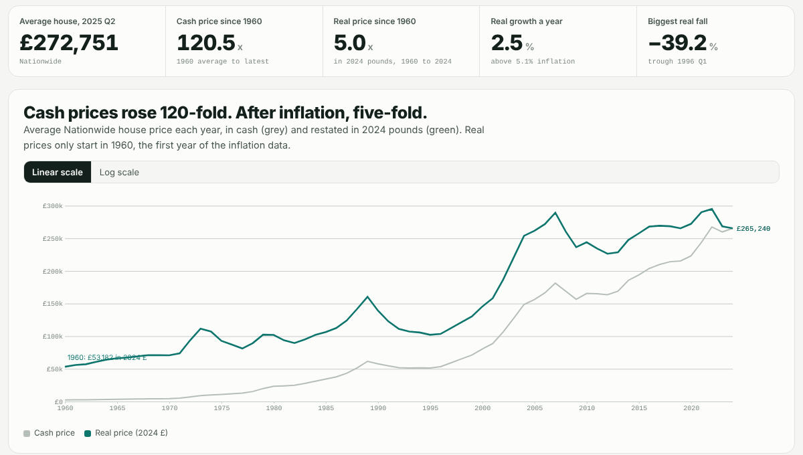
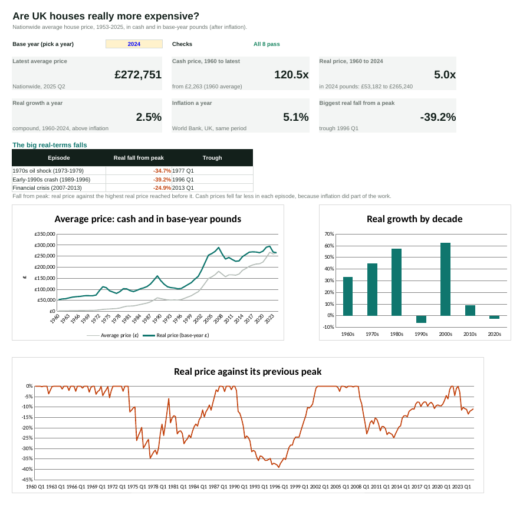
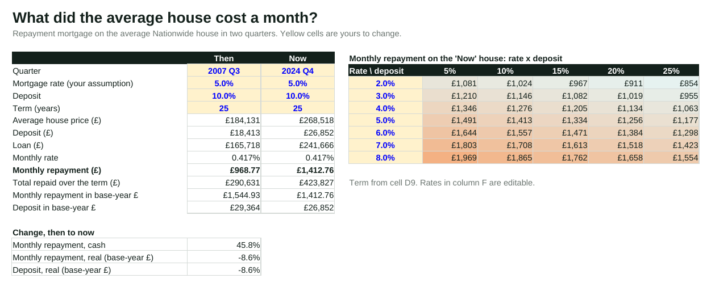

# 120 times dearer, or five? UK house prices in Excel

**An Excel workbook on Nationwide's average house price since 1953, in cash and after inflation. The workbook has 4,842 formulas and no pasted results. You can pick the base year and set the mortgage rates, and the workbook checks itself against the raw data. A separate pandas run recalculates the main figures and confirms them.**

Track: Data Analytics · Excel, Python (openpyxl, pandas), LibreOffice, GitHub Actions · [Live page](https://qaisbello.github.io/data-analytics/uk-house-prices/) · [Download the workbook](UK_House_Prices.xlsx)



## What it shows

| Question | Answer |
|---|---|
| How much dearer is the average house than in 1960? | **120.5 times** in cash (£2,263 to £272,751). After inflation, **5.0 times** (£53,182 to £265,240 in 2024 pounds). |
| How fast have prices beaten inflation? | **2.5% a year**, while inflation averaged 5.1% a year (1960-2024). |
| The worst real-terms crash? | **-39.2%**: from the 1989 peak to the bottom in 1996 Q1. In the 1970s, real prices fell 34.7% while cash prices never fell at all, because inflation did the work. The financial crisis took 24.9% off. |
| And now? | Real prices peaked in **2021 Q4**. By 2024 Q4 they were **10.9% lower** after inflation, while cash prices dipped at most 5.5%. |
| Was 2007 dearer to buy than 2024? | At the same 5% rate and 10% deposit, the monthly repayment on the 2007 Q3 average house was **£1,545 in 2024 pounds**, against **£1,413 in 2024 Q4**. Interest rates are what make the difference, and you set them. |

These comparisons use inflation only. The workbook has no earnings data, so it does not show affordability against incomes.

## The workbook



| Sheet | What it does |
|---|---|
| **Dashboard** | You pick a base year (a dropdown list of 1960 to 2024). The sheet shows six headline figures and the three big falls (found with `MINIFS`), with three charts and a live pass/fail for the checks. |
| **Mortgage** | Compares then and now with `PMT`: repayments in cash and in base-year pounds. It includes a rate x deposit sensitivity grid with a colour scale. The rates are inputs you set, with checks on the values you can enter. |
| **Annual** | One row per year: `AVERAGEIFS` over the quarters, in cash and in real terms, with growth and inflation. |
| **Decades** | Compound growth per decade, in cash and in real terms, against inflation. |
| **Quarterly** | 290 quarters, with the real price, the change on a year earlier, the highest real price so far and the fall from that peak. |
| **CPI** | UK inflation pulled from the 16,000-row World Bank file with `SUMIFS`, chained into an index and rebased to the base year. |
| **Checks** | Eight reconciliation tests (row counts, totals, Nationwide's published changes, and the index equalling 100 in the base year). |
| **Raw_Nationwide, Raw_CPI** | The source data exactly as published. |

**Conventions:**

- **Colours:** blue text in a yellow cell is an input, black is a formula, and green is a value pulled from another sheet.
- **Named ranges:** `BaseYear`, `Q_Price`, `Q_Real`, `Q_Fall`, `CPI_Index` and others.
- **Excel tables:** the main calculation sheets are formatted as tables.
- **Function choice:** the workbook only uses functions that Excel 2010+ and LibreOffice both support (`INDEX`/`MATCH` rather than `XLOOKUP`). That way it opens anywhere and can be checked outside Excel.

```
Inflation for a year      =SUMIFS(Raw_CPI!$D:$D, Raw_CPI!$B:$B, "GBR", Raw_CPI!$C:$C, A6)/100
Chained, rebased index    =C5*(1+B6)      =C6/INDEX($C$5:$C$70, MATCH(BaseYear, $A$5:$A$70, 0))*100
Real price                =IF(G5="", "", E5*100/G5)
Fall from the peak so far =IF(H5="", "", H5/MAX(H$5:H5)-1)
Worst fall in an episode  =MINIFS(Q_Fall, Q_Year, ">=1989", Q_Year, "<=1996")
Monthly repayment         =PMT(C13, C9*12, -C12)
```



## How it is built and checked

- **`tools/build_workbook.py`** writes the workbook with openpyxl.
  - The raw CSVs go in untouched.
  - Every calculation is a formula.
- **`tools/check_workbook.py`** checks the workbook:
  - It recalculates a copy in LibreOffice: 4,842 formulas, no errors.
  - It recomputes from the raw files in pandas and compares the two: every quarter's real price (to the penny), every fall from peak, the annual figures, the mortgage repayment, and all eight tests on the Checks sheet.
  - It writes `data/clean/*.csv` for the web page and saves the results in [`docs/check_results.md`](docs/check_results.md).
- **GitHub Actions** runs both scripts on every push.

```bash
pip install -r requirements.txt
python tools/build_workbook.py
python tools/check_workbook.py      # needs LibreOffice (soffice) on PATH
```

## Data quality

| Issue | Handling |
|---|---|
| The World Bank CPI file's metadata says it holds an index with 2005 = 100. It actually holds annual inflation rates (UK 1975: 24.2; 2024: 3.3). | Treated as rates and chained into an index (1959 = 100). Read as an index, real prices would be meaningless. |
| Inflation is annual; prices are quarterly. | Each quarter is deflated by its year's average price level. |
| Inflation runs to 2024; prices run to 2025 Q2. | 2025 quarters keep cash prices; real prices are left blank on purpose. |
| Nationwide's method changed in 1960, 1974 and 1983. | Kept as published and noted. Long-run comparisons are approximate. |
| Nationwide dates quarters in Feb, May, Aug and Nov. | Labelled Q1 to Q4. |
| Our year-on-year change against Nationwide's published figure | Matches to within 0.07 percentage points (rounding); this is a test on the Checks sheet. |

## Data and licence

- **House prices:** Nationwide Building Society, UK house prices since 1952, via [datasets/house-prices-uk](https://github.com/datasets/house-prices-uk).
- **Inflation:** World Bank consumer price inflation for the United Kingdom, via [datasets/cpi](https://github.com/datasets/cpi).

Both are published under ODC PDDL 1.0. Raw files are in `data/raw`, and calculated tables are in `data/clean`.

---

Built by [Qais Adeniji-Bello](https://qaisbello.github.io) · [LinkedIn](https://www.linkedin.com/in/qais-adeniji-bello/)
